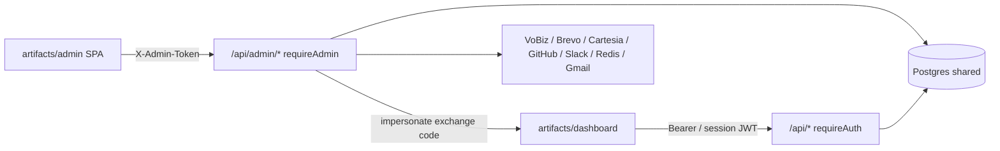

# SnapServe Admin Panel — Architecture & Integration Report

**Generated from codebase inspection of `artifacts/admin` and `artifacts/api-server` admin routes.**  
**Scope:** Admin SPA, `/api/admin/*` backend, shared Postgres, sync with user dashboard.

---

## 1. What the admin panel is

The admin panel is a **separate Vite + React SPA** (`artifacts/admin`), not a section of the user dashboard.

| Concern | Admin | User dashboard |
|--------|--------|----------------|
| Package | `@workspace/admin` → `artifacts/admin` | `@workspace/dashboard` → `artifacts/dashboard` |
| Auth | Static secret `ADMIN_TOKEN` via header `X-Admin-Token` | Google OAuth / password → session JWT |
| API base | `/api/admin/*` | `/api/*` (user-scoped) |
| Data scope | Cross-tenant (all users) | Own workspace only |
| DB | Same Postgres | Same Postgres |

Admin is the **ops / control plane**. The dashboard is the **customer product surface**. They share tables; they do **not** share auth.

---

## 2. High-level architecture



### Request path

1. Admin UI calls `adminFetch()` in [`artifacts/admin/src/lib/api.ts`](artifacts/admin/src/lib/api.ts) with `BASE = "/api/admin"`.
2. Every request sends `X-Admin-Token` from `localStorage.adminToken`.
3. API middleware [`requireAdmin`](artifacts/api-server/src/middlewares/requireAdmin.ts) compares against env `ADMIN_TOKEN` (or optional `SUPER_ADMIN_TOKEN`).
4. Handlers in `artifacts/api-server/src/routes/admin*.ts` read/write shared DB tables.

### Local / Railway serving

- Vite dev proxies `/api` → API server (`:8080`).
- Production can serve the built admin under `/admin-ui/` from the API server static mount.

---

## 3. App structure (frontend)

| Piece | Path |
|-------|------|
| Entry | [`artifacts/admin/src/main.tsx`](artifacts/admin/src/main.tsx) |
| Router + auth gate | [`artifacts/admin/src/App.tsx`](artifacts/admin/src/App.tsx) |
| Layout / sidebar | [`artifacts/admin/src/components/layout.tsx`](artifacts/admin/src/components/layout.tsx) |
| Nav config | [`artifacts/admin/src/lib/nav-config.ts`](artifacts/admin/src/lib/nav-config.ts) |
| API client | [`artifacts/admin/src/lib/api.ts`](artifacts/admin/src/lib/api.ts) |
| React Query hooks | [`artifacts/admin/src/hooks/use-admin-api.ts`](artifacts/admin/src/hooks/use-admin-api.ts) |
| Usage hooks | [`artifacts/admin/src/hooks/use-usage-monitor.ts`](artifacts/admin/src/hooks/use-usage-monitor.ts) |

### Auth gate (client)

- Public: `/login`
- Protected: everything else via `ProtectedRoute` — requires `localStorage.adminToken`
- On HTTP 401/403 → token cleared → redirect to login

### Auth (server)

| Item | Detail |
|------|--------|
| Env | `ADMIN_TOKEN` (required), optional `SUPER_ADMIN_TOKEN` |
| Header | `x-admin-token` |
| Failures | Missing env → 503; wrong token → 403 |
| Identity in audit | String `"admin"` (no admin user row) |

---

## 4. Route map (admin UI pages)

Paths below are relative to the admin app base URL.

### Today / ops

| Route | Page file | Purpose |
|-------|-----------|---------|
| `/` | `pages/overview.tsx` | Ops home: KPIs, spikes, VoBiz wallet, live failures |
| `/platform` | `pages/platform.tsx` | Active sessions + failed calls explorer |
| `/health` | `pages/health.tsx` | Readiness, migrations, env, deploys |
| `/deployments` | `pages/deployments.tsx` | Deploy / GitHub history |
| `/analytics`, `/money`, `/control` | `pages/hubs/*` | Hub landing pages |

### Customers

| Route | Page file | Purpose |
|-------|-----------|---------|
| `/users` | `pages/users.tsx` | User list |
| `/users/:clerkId` | `pages/user-detail.tsx` | Full user ops (wallet, agents, status, impersonate, …) |
| `/users/:clerkId/agents/:agentId` | `pages/admin-agent-edit.tsx` | Edit a user’s agent |
| `/all-agents` | `pages/all-agents.tsx` | Cross-tenant agent list + prompt regen |
| `/partners` | `pages/partners.tsx` | Reseller partners |

### Money

| Route | Page file | Purpose |
|-------|-----------|---------|
| `/finance` | `pages/finance.tsx` | Ledger, Razorpay gaps, investor views |
| `/recharges` | `pages/recharges.tsx` | Wallet top-ups |
| `/phone-purchases` | `pages/phone-purchases.tsx` | DID / number orders |
| `/call-pricing` | `pages/call-pricing.tsx` | Per-minute rates + VoBiz balance |

### Analytics / board / growth

| Route | Page file | Purpose |
|-------|-----------|---------|
| `/call-analytics` | `pages/call-analytics.tsx` | Call volume charts |
| `/growth` | `pages/growth.tsx` | Funnel / cohorts / dropoff |
| `/reports/signups` | `pages/reports/signups.tsx` | Signup lifecycle report |
| `/reports/emails` | `pages/reports/emails.tsx` | Email delivery report |
| `/board/pulse\|growth\|retention\|moat\|unit-economics` | `pages/board/*` | Investor / board metrics |

### Usage monitor

| Route | Page file | Purpose |
|-------|-----------|---------|
| `/usage` | `pages/usage/overview.tsx` | Usage KPIs |
| `/usage/stt\|tts\|llm` | `pages/usage/service.tsx` | Per-service breakdown |
| `/usage/users`, `/workspaces`, `/history` | `pages/usage/*` | By entity / history |
| `/usage/pricing`, `/allocations`, `/alerts` | `pages/usage/*` | Pricing, allocations, alerts |

### Platform config / control

| Route | Page file | Purpose |
|-------|-----------|---------|
| `/managed-keys` | `pages/managed-keys.tsx` | Managed provider API keys |
| `/managed-numbers` | `pages/managed-numbers.tsx` | Shared DID pool / trial limits |
| `/voices` | `pages/voices.tsx` | Cartesia catalog + listed voices |
| `/prompt-template` | `pages/prompt-template.tsx` | Vibe prompt DOCX templates |
| `/system-prompt-templates` | `pages/system-prompt-templates.tsx` | Domain prompt library |
| `/ambient-sounds` | `pages/ambient-sounds.tsx` | Ambient audio library |
| `/scheduling` | `pages/scheduling.tsx` | Cross-user bookings (read) |
| `/gcal-connections` | `pages/gcal-connections.tsx` | Google Calendar connection health |
| `/emails` | `pages/emails.tsx` | Send / browse platform emails |
| `/settings` | `pages/settings.tsx` | Spike alerts, Slack, WhatsApp shared, test email |
| `/dpdp` | `pages/dpdp.tsx` | Right-to-erasure |
| `/audit-logs` | `pages/audit-logs.tsx` | Admin action audit trail |

### Programmes / family

| Route | Page file | Purpose |
|-------|-----------|---------|
| `/events`, `/events/:id` | `pages/events/*` | Workshop CRUD + feedback |
| `/voiceathon/*` | `pages/voiceathon/*` | Voice-a-thon management |
| `/book-interns` | `pages/book-interns.tsx` | Book / intern progress |
| `/family/*` | `pages/family/*` | Insurance family module (mostly localStorage until provision) |

---

## 5. Backend admin modules

Mounted from [`artifacts/api-server/src/routes/index.ts`](artifacts/api-server/src/routes/index.ts) **before** normal user provisioning middleware.

| Backend file | Responsibility |
|--------------|----------------|
| `routes/admin.ts` | Overview, users list, finance summary, platform live/fails, growth, reports, settings, minute rates, health, VoBiz, family provision, DPDP, GCal, book interns |
| `routes/admin-user-mgmt.ts` | User status/profile, providers, calls, agents CRUD, wallet credit/debit/refund, impersonation, audit |
| `routes/admin-finance-analytics.ts` | Deep finance / Razorpay gaps / investor CSV |
| `routes/admin-board-analytics.ts` | Board metrics + board settings |
| `routes/admin-call-analytics.ts` | Call volume series |
| `routes/admin-usage.ts` | Usage monitor, pricing, allocations, alerts |
| `routes/admin-voices.ts` | Cartesia + listed voices |
| `routes/admin-prompt-templates.ts` | Prompt upload/activate + agent regen |
| `routes/admin-system-prompt-templates.ts` | System prompt domains/versions |
| `routes/admin-emails.ts` | Email log + Brevo send |
| `routes/admin-partners.ts` | Partners / pending promotions |
| `routes/admin-deployments.ts` | GitHub deploys / migrations / env |
| `routes/admin-event-feedback.ts` | Workshops |
| `routes/admin-voiceathon.ts` | Voice-a-thon admin |
| `routes/admin-whatsapp.ts` | Shared WhatsApp channel |
| `routes/admin-gender-service.ts` | Gender service diagnostics |
| `routes/ambient-sounds.ts` | Ambient sound CRUD (admin parts) |
| `routes/wizard.ts` | Managed keys / numbers / trial (admin parts) |

**Public bridge (no admin token):**  
`GET /api/impersonate/exchange` — dashboard exchanges a one-time code for a **user session JWT**.

---

## 6. Database tables — what admin touches

Schema lives under [`lib/db/src/schema/`](lib/db/src/schema/).

### Shared with user dashboard (strong coupling)

| Table(s) | Admin use | User dashboard effect |
|----------|-----------|------------------------|
| `users` | Status, email, limits, test flag, concurrent limit | Login blocked if not `active`; profile / limits apply |
| `wallet_transactions` + `users.wallet_balance_cents` | Credit / debit / refund / finance views | Same balance users spend on calls |
| `agents` | CRUD, edit, prompt regenerate, family provision | Same agents in builder / calls |
| `calls` | Failed calls, analytics, per-user history | Call logs / activity |
| `providers` | Inspect user BYO keys | Providers page |
| `phone_number_orders` | Purchase history | Phone numbers / billing |
| `partners` (+ pending) | Create / manage partners | Partner hub + managed clients |
| Scheduling (`bookings`, calendars, …) | Read diagnostics | Scheduling product |
| `usage_events` | Usage monitor | Internal metering for billing/alerts |

### Platform config (admin writes → product reads)

| Table(s) | Effect on users |
|----------|-----------------|
| `platform_settings` | Managed keys, alerts, WhatsApp shared, board settings, trial limits, VoBiz FX, etc. |
| `platform_listed_voices` | Voices shown in agent builder |
| `provider_minute_rates` | Pricing users see / are charged |
| `provider_pricing`, `provider_allocations` | Usage cost model |
| `prompt_templates` | Active vibe / generation template |
| `system_prompt_domains` / `system_prompt_templates` | Domain prompt library |
| `ambient_sounds` | Sounds agents can attach |

### Admin / ops mostly

| Table(s) | Purpose |
|----------|---------|
| `admin_audit_logs` | Who did what in admin |
| `admin_impersonation_sessions` | Support “act as user” |
| `admin_alerts`, spike/notification tables | Ops alerting |
| `platform_emails` | Outbound email log |
| `workshop_events` / `workshop_responses` | Workshops |
| `voiceathon_*` | Voice-a-thon |
| `book_interns` / `book_progress` / … | Book programme |
| `whatsapp_channels` / `whatsapp_messages` | Shared WhatsApp diagnostics |

### Not first-class in admin (dashboard-only product surfaces)

- **Campaigns** CRUD / studios (admin only *observes* related call/finance effects)
- **Production Knowledge Base** RAG tables (`knowledge_sources` / entries) — Family “KB” in admin is largely **browser `localStorage`** until `/family/provision` creates a real `agents` row
- **Journeys / Sheets / Squads** as full product UIs

---

## 7. Sync with user (“user page”) dashboard — detailed

### Strongly synced (admin change → user feels it immediately)

| Admin feature | Shared mechanism | User-facing impact |
|---------------|------------------|--------------------|
| Suspend / activate user | `users.status` | Cannot sign in / use API if not active |
| Wallet credit / debit / refund | `users.wallet_balance_cents` + `wallet_transactions` | Balance, call ability, wallet UI |
| Edit / create agent | `agents` | Agent list, builder, outbound/inbound |
| Managed provider keys | `platform_settings` | Managed ASR/LLM/TTS fallbacks |
| Managed phone numbers / trial | `platform_settings` + VoBiz | Outbound number pool / trial limits |
| Listed voices | `platform_listed_voices` | Voice picker in builder |
| Minute rates | `provider_minute_rates` | Pricing / debit math |
| Prompt templates | `prompt_templates` | Vibe / generation quality |
| Ambient sounds | `ambient_sounds` | Agent ambient options |
| Partners | `partners` | Partner + managed-client UX |
| Impersonation | `admin_impersonation_sessions` + exchange JWT | Support sees exact user dashboard |
| Platform emails | Brevo + `platform_emails` | User receives email |
| DPDP erasure | Erasure pipeline on call/PII data | User data removed per request |

### Read-mostly from admin (inspect, little/no product write)

| Admin feature | Notes |
|---------------|-------|
| Call analytics / failed calls | Reads `calls`; does not place campaigns |
| Finance / recharges / Razorpay gaps | Reads ledger; does not charge cards from admin UI |
| GCal connections | Diagnostics only; OAuth is dashboard-driven |
| Growth / board / signup reports | Analytics over shared events/users/calls |
| Health / deployments / env | Ops only |

### Weak / local-only until provision

| Admin feature | Notes |
|---------------|-------|
| Family companies / policies / KB UI | Mostly `family-store` localStorage; provision writes real `agents` |

### Not synced as admin product modules

| User dashboard area | Admin coverage |
|---------------------|----------------|
| Campaign Studios / list & sheet dial | No admin CRUD UI |
| Agent Knowledge (RAG sources) | No admin KB console (Family KB ≠ product KB) |
| Connections hub (CRM, Sheets UX) | Partial (GCal health only) |
| Vibe builder UI | Indirect via prompt templates / agents |

---

## 8. External services connected to admin

| Service | Admin usage |
|---------|-------------|
| **VoBiz** | Wallet/balance monitor, managed numbers, WhatsApp shared test |
| **Razorpay** | Not charged from admin UI; IDs/gaps inferred from DB transactions |
| **Brevo** | Platform email send |
| **Gmail SMTP** | `POST /admin/test-email` |
| **Cartesia** | Voice list + TTS preview |
| **GitHub** | Deployments / release notes |
| **Groq** | Optional LLM for release-note generation |
| **Redis** | Health ping |
| **Slack** | Alert webhooks from settings |
| **Google Calendar** | Connection diagnostics |
| **Gender / speaker service** | Diagnostics hooks |

---

## 9. Auth model comparison

| | Admin | Normal user |
|--|-------|-------------|
| Credential | `ADMIN_TOKEN` secret | Google / password → JWT (`sub` = clerkId) |
| Header / cookie | `X-Admin-Token` | Session cookie / `Authorization: Bearer` |
| Middleware | `requireAdmin` | `attachSession` + `requireAuth` (+ `provisionUser`) |
| DB identity | None (audit string `"admin"`) | Row in `users` |
| Tenant scope | All tenants | Own `clerkId` / workspace |
| Impersonation | Admin mints code | Dashboard becomes that user (`imp` claim) |

---

## 10. User detail page — deepest sync surface

[`pages/user-detail.tsx`](artifacts/admin/src/pages/user-detail.tsx) is the primary “synced with user page” console. Typical capabilities:

- View profile / status / flags (test user, concurrent limit, unlimited trial)
- Wallet credit / debit / refund + transaction history
- List / open / edit user’s agents
- Inspect providers and recent calls
- Impersonate (opens dashboard as that user)
- Partner linkage
- Send email / view audit trail

Backend: primarily [`admin-user-mgmt.ts`](artifacts/api-server/src/routes/admin-user-mgmt.ts) + pieces of [`admin.ts`](artifacts/api-server/src/routes/admin.ts).

---

## 11. Mutability summary

| Category | Read | Write |
|----------|------|-------|
| Overview / platform / health / deployments | Yes | Limited (dismiss spikes) |
| Users / wallet / agents / partners | Yes | **Yes** |
| Finance / recharges / phone purchases | Yes | Rates CRUD on call-pricing |
| Usage pricing / allocations / alerts | Yes | **Yes** |
| Managed keys / numbers / voices / prompts / ambient / settings | Yes | **Yes** |
| Emails / DPDP | Yes | **Yes** |
| Board settings | Yes | **Yes** (pulse settings) |
| Family UI | Local + provision | Local + agent create |
| Campaigns / product KB | — | **Not in admin** |

---

## 12. Practical mental model

1. **Admin = control plane** over shared SnapServe Postgres.
2. **Dashboard = customer plane** with JWT scoping.
3. Strongest shared surfaces: **users, wallet, agents, platform_settings, voices, rates, prompts**.
4. Weakest / absent admin coverage: **campaigns product UI**, **Agent Knowledge RAG**, full **connections** product.
5. Family module is a special case: UI is mostly client-local until provision creates a real agent.

---

## 13. Key source index

```
artifacts/admin/src/
  App.tsx, main.tsx
  lib/api.ts, lib/nav-config.ts
  hooks/use-admin-api.ts, hooks/use-usage-monitor.ts
  pages/**  (all admin screens)

artifacts/api-server/src/
  middlewares/requireAdmin.ts
  routes/admin*.ts
  routes/index.ts          # mounts admin before user provisioning

lib/db/src/schema/         # shared tables
```

---

*This report describes architecture as implemented in the repository. Runtime URLs and secrets (`ADMIN_TOKEN`, DB, provider keys) come from environment / Railway variables, not from hardcoded development URLs in the admin app.*
