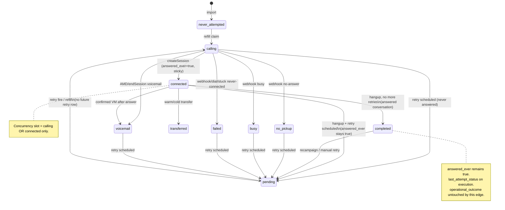
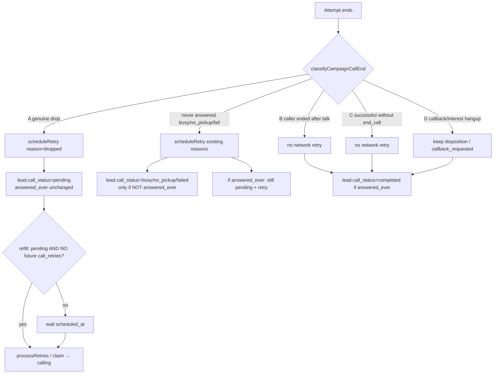

# Campaign lead state refactor (design only)

**Date:** 2026-09-19  
**Status:** implemented (writers + reporting UI). Promote steps: [`docs/campaign-lead-state-v2-promote.md`](./campaign-lead-state-v2-promote.md). Remap script: `artifacts/api-server/src/scripts/remap-answered-failed-leads.ts`.  
**Companion audits:** `docs/campaign-logic-schema.md`, `docs/campaign-failed-status-audit.md`.

---

## 0. Why `call_status` cannot stay as the one field

Today `campaign_leads.call_status` is used as:

1. Contact history (implied: `completed` ≈ answered, `failed` ≈ never worked)
2. Current lifecycle (`calling` / `connected` / `pending`)
3. Retry parking (`failed` so refill will not re-dial until `call_retries` fires)
4. Business result (Failed chip)

Those four disagree after any answered hangup. Production batch 412: **104 / 128** Failed leads have `calls.status = completed` and duration > 0. Call-ended log on those rows is **`user_hangup` / expected=true** (“Caller hung up”), while campaign retry reason is **`network_drop`**.

---

## 1. Canonical state model (four layers)

```
campaign_leads
├── contact_state          (monotonic history)
├── call_status            (lifecycle / slot only)
├── call_retries[]         (retry queue — already exists)
└── operational_outcome + disposition  (business — already exists)

call_executions + calls    (attempt-level technical — already exist)
```

### Layer 1 — Contact state (history, never rewritten backwards)

| Value | Meaning | How it is known today | After refactor |
|---|---|---|---|
| `never_attempted` | Not dialed | `call_attempts = 0` | same, or `contact_state` |
| `attempted` | ≥1 dial, never answered | `call_attempts > 0` AND `call_id IS NULL` | `attempted` |
| `answered` | ≥1 session started | `call_id IS NOT NULL` | **`answered_ever = true`**, sticky |

**Invariant:** `answered_ever` flips true on `createSession` and is never set false. A later busy / no-pickup / dial fail / mid-drop **must not** erase it.

### Layer 2 — Current lifecycle (`call_status`, narrowed)

In-flight (counts as a concurrency slot):

| Value | Meaning |
|---|---|
| `calling` | Claimed, ringing / connecting |
| `connected` | Live answered session |

Not a slot:

| Value | Meaning |
|---|---|
| `pending` / `queued` | Eligible to be claimed **unless** a future `call_retries` row exists |
| `completed` | Parked after an **answered** attempt; no in-flight retry (or retries exhausted with a conversation) |
| `no_pickup` / `busy` / `voicemail` / `failed` / `skipped` / `exhausted` | Parked after a **never-answered** (or exhausted never-answered) attempt |
| `transferred` | Parked after human transfer |

**Rule:** `failed` is only for **technical / never-answered** terminals (carrier fail, dial throw, stuck never-connected, exhausted without an answer). It is **not** allowed as the parked state of a lead with `answered_ever = true`.

After an answered hangup **with** a scheduled retry: `call_status = pending` (refill already skips `call_retries.scheduled_at > now()`). Today this interval is stored as `failed`, which is why the Failed chip fills up for an hour.

### Layer 3 — Retry (`call_retries`, reuse)

Do not add a second retry table.

| Column | Role |
|---|---|
| `status` | `pending` \| `fired` \| `cancelled` |
| `reason` | technical / policy reason for the **next** dial |
| `scheduled_at` | refill gate |
| `attempt_number` | next attempt |

Eligibility = `EXISTS call_retries WHERE status='pending'`, **not** `call_status='failed'`.

`retryEngine.processRetries` already skips `calling` and `completed`. After this refactor it must **also skip** `connected`, and must **allow** `pending` (already does).

Reason vocabulary (attempt-level, not business):

| Reason | When to schedule |
|---|---|
| `no_pickup` / `busy` / `failed` / `voicemail` | Never-answered carrier/AMD (unchanged webhook path) |
| `dropped` | Classifier A — genuine mid-call media/network drop |
| `stuck_calling` | Sweep (unchanged) |
| `manual` | Operator retry |
| **do not use `network_drop` for caller hangup after a real conversation** | See §8 |

Callback **business** (“call me Monday”) is `operational_outcome = callback_requested` + `scheduled_callbacks` / `call_callbacks`, not a `network_drop` retry unless the operator still wants a campaign redial.

### Layer 4 — Business (already exists)

- `disposition` — agent taxonomy `"primary: sub"`
- `operational_outcome` — `pending | interest_confirmed | booking_created | transfer_completed | callback_requested | no_contact | dnc_blocked | failed`

**Invariant:** a later technical attempt must not clear disposition. `applyCampaignDispositionOutcome` may **upgrade** (e.g. busy → interested) but must not overwrite a positive/callback/booking/transfer with empty/`NOT_CONNECTED` from a no-connect retry.

`computeOperationalOutcome` must stop treating lead `call_status === 'failed'` as stronger than an existing positive disposition (it already prefers disposition **if present**; the bug is writing `failed` onto `call_status` and first-pass outcome before disposeCall). First-pass in `endSession` should not set `operational_outcome=failed` when `answered_ever` and a retry or conversation exists.

### Attempt-level technical (calls / executions)

| Store | Field | Role |
|---|---|---|
| `calls.status` | already | session outcome: `completed`, `no_pickup`, `failed`, `voicemail`, `transferred` |
| `calls.conversation_completed` | already | closing-phrase / naturalEnd / transfer / booking |
| `call_executions.outcome` | **exists, mostly unused** | write on every attempt: `answered`, `caller_hangup`, `agent_end`, `dropped`, `busy`, `no_pickup`, `failed`, `voicemail`, `dial_error`, `transferred` |
| `execution_logs` `callEnded.reason` | already | `user_hangup` (expected), `media_disconnect` (unexpected), `end_call`, `silence_timeout`, … |

List UI “this attempt was busy” reads **execution/calls**, not lead `failed`.

---

## 2. Schema changes (minimal)

### Add

```sql
ALTER TABLE campaign_leads
  ADD COLUMN answered_ever boolean NOT NULL DEFAULT false;
-- backfill
UPDATE campaign_leads SET answered_ever = true WHERE call_id IS NOT NULL;
CREATE INDEX campaign_leads_answered_ever_idx ON campaign_leads (batch_id) WHERE answered_ever;

ALTER TABLE campaign_leads
  ADD COLUMN last_attempt_status text;
-- denorm of latest technical result for filters without a join
```

Optional generated/check (not required for v1):

```sql
-- contact_state can stay derived:
-- never_attempted: call_attempts = 0
-- attempted: call_attempts > 0 AND NOT answered_ever
-- answered: answered_ever
```

### Reuse, do not duplicate

| Existing | Keep |
|---|---|
| `call_status` | lifecycle + parked **never-answered** terminals |
| `call_retries` | the only retry state |
| `operational_outcome`, `disposition` | business |
| `call_id`, `call_attempts`, `last_attempt_at` | last answered call + attempt counter |
| `call_executions` | one row per **answered** session; `outcome` filled; unanswered attempts stay execution-less (or later add stub rows — not required for v1) |
| `calls.*` | duration, cost, conversation_completed, disposition_result |
| `lead_timeline` | audit |

### Do not add

- A second retry table
- A new “Failed vs Interested” mega-enum on the lead
- Rewriting historical `call_status` on old rows except a **one-time optional** remap of answered+failed → `pending`/`completed` (see §7)

---

## 3. State transition diagram



**Forbidden:** `answered_ever=true` → lead `call_status=failed`.

---

## 4. Retry transition diagram



Refill already implements the gate (`batchScheduler.ts` ~563–568, `campaignCaller.ts` ~267–272). Parking answered retries as `pending` instead of `failed` is compatible with concurrency **if** that gate stays.

---

## 5. KPI definitions after refactor

All counts are **leads**, not executions.

| Chip | SQL |
|---|---|
| Imported | `count(*)` |
| Called / attempted | `call_attempts > 0` |
| **Answered-ever** (replaces today’s “Connected” as a funnel) | `answered_ever` (equiv. `call_id IS NOT NULL` after backfill) |
| Talking now | `call_status = 'connected'` |
| Ringing now | `call_status = 'calling'` |
| **Latest** no-pickup / busy / failed / voicemail | `last_attempt_status` (or join latest execution/calls) **and not** used as answered-ever |
| Interested / booked / transferred | `operational_outcome` (unchanged) |
| Callbacks | existing callback tables + `callback_requested` |
| Retry queue | `call_retries.status = 'pending'` |
| Success rate | Interested / **Answered-ever** (not Interested / Called) — product choice; document both |

**Mutually exclusive:** talking vs ringing vs parked.  
**Not exclusive:** Answered-ever ∩ Interested ∩ Retry-pending.

Today’s Connected KPI (`call_status in connected,completed,transferred`) **drops answered-then-parked-failed leads**. After refactor, Answered-ever keeps them; talking-now stays `connected` only.

---

## 6. Backwards compatibility / migration

### Dual-write window (required)

1. Add `answered_ever` + `last_attempt_status` (nullable).
2. Backfill `answered_ever` from `call_id IS NOT NULL`.
3. Backfill `last_attempt_status` from `calls.status` of `call_id`, else current `call_status`.
4. **Keep writing `call_status`** for in-flight (`calling`/`connected`) exactly as today so concurrency does not change.
5. Change **only** the answered hangup writer (`endSession` campaign branch): stop setting lead `failed` on mid-drop; write execution outcome + `scheduleRetry(dropped)` + `call_status=pending` when retrying, else `completed`.
6. KPI SQL: add Answered-ever; keep old Failed SQL behind a flag for one release so dashboards can be compared.
7. Do **not** remap historical `failed` rows in place in the same deploy as the writer change (counts would jump overnight). Optional follow-up job:

```sql
-- optional, gated, after validation
UPDATE campaign_leads l
SET call_status = CASE
  WHEN EXISTS (SELECT 1 FROM call_retries r WHERE r.lead_id=l.id AND r.status='pending')
    THEN 'pending'
  ELSE 'completed'
END
WHERE answered_ever AND call_status = 'failed';
```

Old UI that filters `status=failed` will show **fewer** rows (only never-answered fails). That is correct; do not keep writing fake `failed` to preserve the chip.

### Readers that must tolerate both

Any query using `call_status='failed'` as “bad outcome” must switch to `last_attempt_status` / `operational_outcome` / `NOT answered_ever`. Ship SQL changes in the same release as the writer.

---

## 7. Files / functions to change (implementation later)

### Write path (lifecycle + retry)

| File | Function | Change |
|---|---|---|
| `session.ts` | `createSession` campaign block | set `answered_ever=true` |
| `session.ts` | `endSession` `terminalLeadStatus` / `midConvDrop` | replace with `classifyCampaignCallEnd`; never `failed` if `answered_ever`; park `pending`/`completed` |
| `session.ts` | first-pass `computeOperationalOutcome` | do not set `failed`/`no_contact` before disposeCall when answered |
| `session.ts` | `applyCampaignDispositionOutcome` call | pass lifecycle status, not “failed”; never clear positive disposition |
| `campaign-disposition-outcome.ts` | `applyCampaignDispositionOutcome` | skip overwrite if new label empty/`NOT_CONNECTED` and existing disposition is positive/callback |
| `operational-outcome.ts` | `computeOperationalOutcome` | `call_status=failed` must not beat existing interest/callback/booking/transfer; failed only if never answered + exhausted |
| `webhooks.ts` | `handleCampaignLeadTerminalStatus` | if `answered_ever` and still `connected`, **do not** map carrier `failed` onto the lead (endSession owns); never-answered path unchanged |
| `campaignCaller.ts` | dial catch / max-attempts | `failed` only if `!answered_ever`; else `pending`+retry or `completed` |
| `campaignCaller.ts` | `recordCallExecution` | set `call_executions.outcome` |
| `retryEngine.ts` | `scheduleRetry` / `processRetries` | skip `connected`; treat `pending`+future retry as wait; stop requiring `failed` |
| `batchScheduler.ts` | `sweepStuckCallingLeads` | stuck `connected` + `answered_ever` → `pending`+retry or `completed`, not lead `failed` |
| `live-queue.ts` | bulk retry/pause, metrics `failed` | exhausted = never-answered failed/exhausted, not answered hangup |

### KPI / API

| File | Change |
|---|---|
| `lib/campaign-lead-funnel.ts` | Answered-ever; Failed = never-answered `last_attempt_status`/`call_status`; keep talking/ringing separate |
| `routes/batch-workspace.ts` | leads payload: expose `answeredEver`, `lastAttemptStatus`, execution outcomes; duration still from `call_id` |
| `routes/campaign-analytics.ts` | same funnel |
| `routes/live-queue.ts` | Connected = talking now; add answered-ever if needed |
| `routes/campaigns.ts` | dashboard stats |
| `routes/command-center.ts` | stop `callStatus==='failed' \|\| operationalOutcome==='failed'` mash |
| `lib/db/src/schema/campaigns.ts` | new columns |

### UI (later, not this work)

`[batchId].tsx`, `[id].tsx` BatchKpiCard, `campaign-status.ts`, Live Queue — Status column = lifecycle or last attempt technical; business = disposition.

### Tests

`operational-outcome.test.ts`, new `classifyCampaignCallEnd` tests, `batchScheduler` refill+retry gate, webhook “connected + carrier failed” race, retryEngine completed-skip.

---

## 8. `midConvDrop` audit (why normal talks become `network_drop`)

### Current campaign rule

```
!voicemail && !naturalEndTriggered && !wasTransferred && durationSeconds > 15
→ lead failed + scheduleRetry(network_drop)
```

### What `naturalEndTriggered` actually is

Set only when pipeline `onCallEnd` runs `triggerNaturalEnd()` — i.e. **agent `end_call`**, caller-farewell auto-end (`turnIndex >= 3` + `isCallerClosingUtterance`), silence timeout path, etc.

**Caller hanging up the handset does not set it.** WS close → `endSession` with `reason` default `user_hangup`.

### Signals that already exist but campaign ignores

| Signal | Where | Campaign midConvDrop uses it? | Non-campaign auto-redial uses it? |
|---|---|---|---|
| `conversationCompleted` (closing phrases / booking / transfer / naturalEnd) | `session.ts` ~3098 | **No** | **Yes** (`wasUnexpectedDrop`) |
| `transcriptHasFarewellEnding` | `callFarewell.ts` | **No** | **Yes** |
| Turn count `metricsAcc.count` | session | **No** (only duration>15) | Yes (suppress 0-turn) |
| `endReasonHint` `media_disconnect` / `silence_timeout` / `max_duration` | pipeline | **No** | memory-drop uses them (~4211) |
| `callEnded.reason=user_hangup` `expected=true` | `execution-log.ts` | **No** | n/a |
| Disposition interested / callback / not_interested | disposeCall (async **after** midConvDrop) | **No** (runs too late) | n/a |
| Last user utterance (“Call me Monday”) | callEnded | **No** | n/a |

Non-campaign redial already treats closing-phrase + farewell as **not** a drop. Campaign path does not. That is the classification bug, not “retry exists”.

### Production (batch 412, Failed + duration)

Call **26475** (lead 11414): 18s, 1 turn, last user *“No no not now I am driving ya. Call me Monday.”*, last agent *“Okay, I've noted that”*, `callEnded.reason=user_hangup`, `expected=true`, disposition `call back requested`, campaign retry **`network_drop`**. This is **D**, not **A**.

Call **26477** (lead 11431): 38s, 5 turns, Tamil conversation, `calls.status=completed`, `conversation_completed=false`, disposition `interested`, retry `network_drop`. **C/B**, not A.

Call **26441** (lead 11810): 29s, 3 turns, caller agrees they need funds, interested, same.

Almost all Failed+duration rows: `conversation_completed=false`, `user_hangup` expected, duration 16–60s (the `>15` gate).

### Proposed classifier `classifyCampaignCallEnd` (do not just delete retries)

Evaluate **before** `scheduleRetry`, using session fields already in `endSession` (disposition may still be async — use transcript/farewell/turns/endReason first; a second pass after disposeCall may **cancel** a pending `dropped` retry if the label is callback/interested/not_interested).

| Class | Conditions (any sufficient set) | Retry? | Lead park | Execution outcome |
|---|---|---|---|---|
| **A genuine drop** | `endReasonHint` in `media_disconnect`,`early_media_drop` **or** (`expected=false` and no farewell and no closing and turns≥1 and mid-sentence / waiting-for-reply) | **Yes** `dropped` | `pending` if attempts remain | `dropped` |
| **B caller ended after talk** | `user_hangup`/`disconnected` **and** (turns≥1 **or** duration>15) **and** not A | **No** network retry | `completed` if answered | `caller_hangup` |
| **C success without end_call** | `naturalEnd` **or** `conversationCompleted` **or** `transcriptHasFarewellEnding` **or** closing phrases | **No** | `completed` | `agent_end` / `completed` |
| **D callback/interest hangup** | B or C **plus** callback/interest/not_interested/busy-in-conversation disposition (second pass) | **No** `network_drop`. Callback meaning → `callback_requested` only | `completed` | `caller_hangup` |
| Never answered | webhook busy/no_pickup/failed, duration 0, no session | existing retry reasons | existing terminals | no execution |

Busy-as-disposition after a 38s talk is **B/D**, not carrier busy. Do not map it to lead `busy` if `answered_ever`.

Silence timeout / max duration: expected timeouts; retry only if campaign policy says so (`reason=voicemail` or a new `timeout`), **not** `network_drop`.

**Do not** fold A into C. Media disconnect while waiting for a short reply (`noteMediaDropIfWaitingForReply`) remains retryable.

Second pass after `disposeCall`: if a `dropped` retry is pending and taxonomy is interested/callback/not_interested/booked, **cancel that retry** (keep `scheduled_callbacks` if the tool already scheduled one).

---

## 9. Risks (scheduler / concurrency / webhooks)

| Risk | Mitigation |
|---|---|
| Refill double-dials if answered hangup goes to `pending` without a future retry row | Always insert `call_retries` **before** setting `pending`, same transaction/order as today (`scheduleRetry` then park). Gate already in refill SQL. |
| `processRetries` skips `completed` — if we park answered as `completed` too early, retries never fire | Park `pending` whenever `scheduleRetry` returned true |
| Webhook `failed` while lead still `connected` overwrites park | If `answered_ever` and `connected`, ignore carrier terminal (`endSession` owns) — already the intent of `NON_TERMINAL_OR_CONNECTED_STATUSES` for hangup/completed; extend to not clobber after answer |
| Stuck sweep marks live `connected` as `failed` | If `answered_ever`, park `completed`/`pending`+retry; free the slot without fake Failed |
| Concurrency undercount | **Do not** change `calling`/`connected` meaning. Platform/campaign caps stay `IN ('calling','connected')` |
| Concurrency leak | Park must leave `calling`/`connected` on hangup (endSession already does). Tests: slot freed when parking `pending` |
| Batch completion | Already uses pending leads + in-flight + **pending retries**. Parking `pending`+retry keeps batch open (good) |
| KPI shock | Dual-read flag; optional historical remap later |
| `call_executions` only on answer | Unanswered attempts have no execution; `last_attempt_status` must be written on webhook path too |
| Disposition race | midConvDrop currently runs **before** disposeCall; classifier first pass without taxonomy; second pass cancels false `dropped` retries |
| Live Queue “Exhausted” = `call_status=failed` | Will shrink; map to never-answered failed + max attempts |

---

## 10. Tests required (when implementing)

- `classifyCampaignCallEnd`: A vs B vs C vs D fixtures from calls 26475, 26477, 26441, plus a synthetic `media_disconnect` mid-question.
- Answered then later no-pickup retry: `answered_ever` stays true; `call_status` pending→calling→no_pickup; disposition still interested.
- Mid-drop A: retry `dropped`, lead `pending`, operational_outcome not `failed`.
- Caller hangup after “call me Monday”: no `network_drop` retry; `callback_requested`.
- Refill will not claim `pending` with future `call_retries`.
- `createSession` sets `answered_ever`; webhook never-answered `failed` does not.
- Concurrency: hangup to `pending` decrements calling/connected count by 1.
- `computeOperationalOutcome` never returns `failed` when disposition is interested.
- Stuck sweep on `connected` + `answered_ever` does not write lead `failed`.
- Funnel: Answered-ever ≥ Interested; Failed ∩ Answered-ever = 0.

---

## 11. Rollout plan

1. **Schema** — add columns, backfill `answered_ever`, deploy with writers still old (safe).
2. **Flag** `CAMPAIGN_LEAD_STATE_V2=off` — ship classifier + park logic behind flag on canary agents/campaigns (e.g. 449).
3. **Compare** Failed KPI old vs new, retry counts, talking concurrency, for 24h on canary.
4. **Flag on** for all new hangups; do not remap old `failed` yet.
5. **KPI SQL** switch (Answered-ever chip; Failed = never-answered).
6. **Optional remap** of legacy answered+`failed` rows.
7. **UI** (separate change) — Status = lifecycle / last attempt; disposition = business.

No UI in this refactor. No commit until implementation is requested.

---

## 12. Decision summary

| Question | Decision |
|---|---|
| What is `call_status`? | Slot + parked lifecycle only |
| Where is answered-ever? | New sticky `answered_ever` (backfilled from `call_id`) |
| Where is retry? | Existing `call_retries` |
| Where is business? | Existing `disposition` + `operational_outcome` |
| Where is “this call failed”? | `calls` + `call_executions.outcome` + `last_attempt_status` |
| May an answered lead be lead-`failed`? | **No** |
| May we retry a genuine drop? | **Yes**, reason `dropped`, lead stays `pending`, business intact |
| Is `network_drop` on caller hangup after a talk correct? | **No** — that is B/C/D |
